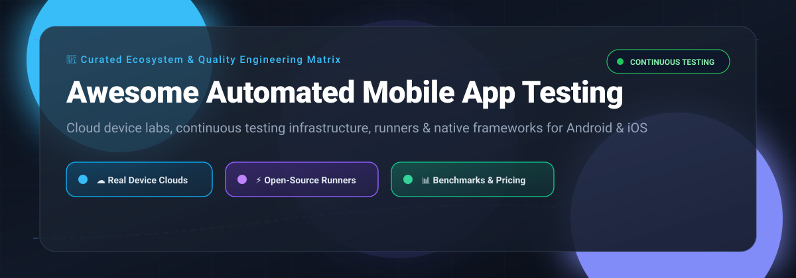

# 📱 Awesome Automated Mobile App Testing 🚀

**A curated, production-grade guide to automated mobile app testing platforms, cloud device farms, native frameworks, and open-source test runners for Android & iOS.**

  
  
  
  
  
  

  <a href="#-sector-overview--market-dynamics">Sector Overview</a> •
  <a href="#-saas-mobile-testing-platforms--device-clouds">SaaS Platforms & Pricing</a> •
  <a href="#-open-source-mobile-test-runners--frameworks">Open-Source Frameworks</a> •
  <a href="#-local-ai-qa-agents">Local AI QA Agents</a> •
  <a href="#-star-history">Star History</a> •
  <a href="#-support--community">Support</a>

---

## 📈 Sector Overview & Market Dynamics

The global mobile application testing market is valued between **$8.6 Billion and $14.8 Billion** (projected to exceed $17 Billion with a CAGR of ~13%–17%), driven by exponential smartphone device fragmentation, 5G deployments, and rapid DevOps continuous testing cycles. The sector exhibits a **hybrid, moderately concentrated structure**: while the bottom and mid-tier developer segments remain highly fragmented across thousands of regional QA consultancies and open-source test frameworks (such as Appium and Maestro), the top-tier enterprise cloud device farm and automated quality infrastructure space is moderately concentrated among hyperscalers (AWS, Google) and specialized quality engineering platforms (BrowserStack, Perforce/Perfecto, SmartBear/BitBar, and Sauce Labs).

---

## ☁️ SaaS Mobile Testing Platforms & Device Clouds

The table below lists leading commercial mobile testing clouds, automated device labs, and real-device testing infrastructure. Sorted in descending order by parent company scale (valuation / annual revenue).

| Platform | Company Scale (Valuation / Revenue) | Entry Pricing | Free Tier / Free Trial Limits | Description & Key Capabilities |
|---|---|---|---|---|
| **[AWS Device Farm](https://aws.amazon.com/device-farm/)** 🏷️ | **~$2 Trillion+ Market Cap** (~$100B+ ARR AWS run rate) | **$0.17 / device-minute** (Pay-as-you-go); Unmetered from **$250 / slot / month** | **1,000 device-minutes** (One-time free trial on sign-up) | Real-device cloud for running automated Android and iOS test suites (Appium, Espresso, XCUITest) and remote debugging. |
| **[Firebase Test Lab](https://firebase.google.com/docs/test-lab)** (Google) 🧪 | **~$2 Trillion+ Market Cap** (~$300B+ annual revenue) | **$1.00 / hour** (Virtual); **$5.00 / hour** (Physical) on Blaze plan | **Spark Plan (Free forever)**: 10 virtual tests/day (max 60 min/day) & 5 physical tests/day (max 30 min/day) | Cloud-based app-testing infrastructure integrated directly with Google Cloud and Firebase; automated Robo test support. |
| **[Perfecto](https://www.perfecto.io/)** (Perforce Software) 🎯 | **~$500M–$750M ARR** (Enterprise Valuation ~$2B+) | From **$83 / month** (Manual); Automation plans start at **$300 / month** | **14-day free trial** (Includes ~240 minutes of testing on public cloud real devices) | Enterprise-grade cloud for continuous web and mobile automation with enterprise biometric, network, and audio virtualization. |
| **[BrowserStack App Automate](https://www.browserstack.com/app-automate)** ⚡ | **$4 Billion Valuation** (~$230M ARR) | **$199 / month** (Billed annually; $249 / month billed monthly) per parallel test | **100 minutes** of automated mobile app testing + 30 min interactive live testing (No fixed day limit) | Scalable real-device mobile cloud supporting Appium, Espresso, XCUITest, Flutter, and EarlGrey with fast local testing tunnels. |
| **[BitBar](https://smartbear.com/product/bitbar/)** (SmartBear) 🐻 | **~$1.8B–$1.9B Valuation** (~$150M+ ARR) | **€45 / parallel / month** annual (Live); **€202 / parallel / month** (Unlimited automated) | **14-day free trial** (Full functional trial on real devices; free tier available for approved open-source projects) | Flexible mobile app and web testing cloud supporting any native mobile test framework without vendor lock-in. |
| **[Sauce Labs](https://saucelabs.com/)** 🌶️ | **~$613 Million Valuation** (~$50M–$100M ARR) | **$149 / month** annual ($199/mo monthly) for Virtual; **$199 / month** annual for Real Devices | **28-day free trial** (Includes 60 automated/live testing minutes across 3 parallel virtual machines) | Real-device cloud and emulators/simulators with integrated error reporting, automated test analytics, and Sauce Connect VPN. |
| **[LambdaTest](https://www.lambdatest.com/)** 🌐 | **~$400 Million Valuation** (~$80M–$120M ARR) | **$15 / month** (Live manual); Automation starting from **$79 / month** | **Free Forever plan**: 60 minutes/month automated web/mobile testing + 6 live sessions of 10 min each | Unified testing cloud supporting automated mobile testing across physical devices and emulators with real-time debugging. |
| **[HeadSpin](https://www.headspin.io/)** 🔮 | **~$50M–$100M Valuation** (~$15M–$20M ARR) | **$49 / month** (CloudTest Lite, 40 hrs manual); **$83 / month** (CloudTest Go) | **14-day free trial** upon approved sales demo request (No self-serve open-ended free tier) | AI-driven global device infrastructure providing real-world performance metrics, audio/video QoE, and network emulation. |
| **[Kobiton](https://kobiton.com/)** 📱 | **~$40M+ Funding Raised** (Series B stage) | **$83 / month** (Startup plan, includes 500 device-minutes/month) | **15-day free trial** (Includes 120–300 minutes of real device access without commitment) | Mobile testing platform offering real device access, scriptless test automation generation, and on-premises private cloud deployment. |
| **[TestGrid](https://testgrid.io/)** 🤖 | **~$5M+ ARR** (Early/Growth stage funding) | **$199 / seat / month** (Starter CoTester plan) | **Guided free trial / PoC** via sales request (Custom days/limits configured per evaluation) | End-to-end AI-powered testing platform providing codeless mobile automation, real-device cloud access, and IoT device testing. |

---

## 🛠️ Open-Source Mobile Test Runners & Frameworks

Open-source automation runners, device control tools, and test frameworks execute tests on local devices, simulators, emulators, or connected cloud device farms.

Repositories below are sorted in descending order by GitHub Stars_Count:

| Repository & GitHub_Stars | Description | Target Platforms | Primary Drivers / Cloud Support |
|---|---|---|---|
| **[Appium](https://github.com/appium/appium)**  | The industry standard, cross-platform test automation framework for native, hybrid, and mobile web apps utilizing the W3C WebDriver specification. | Android, iOS, Windows, macOS | Appium Drivers (UIAutomator2, XCUITest, Espresso), all cloud farms |
| **[Maestro](https://github.com/mobile-dev-inc/maestro)**  | Modern, fast, and simple UI automation framework for mobile apps with declarative, clean YAML syntax and built-in flakiness tolerance. | Android, iOS, React Native, Flutter | Built-in Maestro driver, local devices & cloud farms |
| **[OpenSTF](https://github.com/openstf/stf)**  | Smartphone Test Farm (STF) for controlling and managing real Android devices from your browser remotely in real-time. | Android | ADB, Browser-based remote interactive control |
| **[Detox](https://github.com/wix/Detox)**  | Gray-box end-to-end testing and automation library designed specifically for React Native apps with automatic synchronization. | Android, iOS (React Native) | Native Espresso and Early synchronization hooks |
| **[Airtest](https://github.com/AirtestProject/Airtest)**  | Cross-platform UI automation framework using image recognition and dynamic element inspection for games and mobile apps. | Android, iOS, Windows, Unity | Python, OpenCV image recognition, ADB |
| **[Android Testing Samples](https://github.com/android/testing-samples)**  | Official Google repository of Android architectural blueprints and test automation samples demonstrating Espresso, UIAutomator, and Robolectric. | Android | AndroidX Test, Espresso, JUnit |
| **[Robolectric](https://github.com/robolectric/robolectric)**  | Fast unit-testing framework that runs Android SDK code directly inside the JVM on your desktop workstation without booting an emulator. | Android | Java/JVM, Android SDK emulation |
| **[idb](https://github.com/facebook/idb)**  | "iOS Development Bridge" by Meta: a flexible command-line companion interface for automating iOS simulators and physical devices. | iOS | CLI, Python, gRPC |
| **[WebDriverAgent](https://github.com/appium/WebDriverAgent)**  | WebDriver server implementation for iOS that can be used to remote control iOS devices and simulate touch actions via Apple's XCTest. | iOS (XCTest) | XCTest, Appium iOS driver backend |
| **[Kaspresso](https://github.com/KasperskyLab/Kaspresso)**  | Robust Android UI testing framework based on Espresso and UIAutomator with flakiness protection, DSL, and ADB interceptor steps. | Android | Espresso, Kakao DSL, UIAutomator |
| **[Appium Inspector](https://github.com/appium/appium-inspector)**  | GUI inspector app for exploring UI hierarchies, inspecting mobile app elements, and recording test automation code for Appium. | Android, iOS | Electron, Appium Server |
| **[maestro-runner](https://github.com/devicelab-dev/maestro-runner)**  | Open-source, lightweight CLI test runner alternative for Maestro mobile UI test workflows; 100% free with no JVM overhead. | Android 5.0+, iOS 15.0+ | DeviceLab driver, UIAutomator2, Appium, Cloud farms |

---

## 🤖 Local AI QA Agents

Tools that run locally with configured model access and a browser or device environment. Check the listed license for permitted use.

| Tool | Targets | License & local costs | Description |
|---|---|---|---|
| [agent-qa](https://vostride.com) ([source](https://github.com/vostride/agent-qa)) | Android and iOS | FSL-1.1-ALv2; free local software for permitted use, model/device costs separate | Natural-language QA with persistent memidex memory, validated self-improvement and recorded steps/screenshots; CLI, dashboard and MCP. |

---

## 📊 Star History

---

## 💖 Support & Community

Thank you for exploring **Awesome Automated Mobile App Testing**! If you find this resource helpful for your QA pipelines and test automation projects:

- ⭐ **Star this repository** to show your appreciation and help fellow developers discover it.
- 🍴 **Fork and contribute** by submitting PRs with new tools, updated pricing, or bug fixes.
- 📢 **Share with colleagues** in DevOps, QA, and mobile engineering teams.
- ☕ **Sponsor & Buy a Coffee**: Support ongoing maintenance and curated developer lists via the [GitHub Sponsors Dashboard](https://github.com/sponsors/ishandutta2007).
